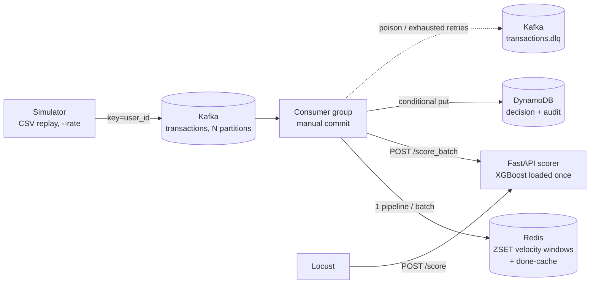

# SentinelStream: Real-Time Fraud Risk Scoring Pipeline

Event-driven pipeline that replays card transactions into Kafka, computes sliding-window velocity
features in Redis, scores each event with an XGBoost model behind a FastAPI service, and writes an
approve / review / block decision plus audit record to DynamoDB.

> **Status of numbers:** this repo ships with **no performance claims**. Every number in the
> Results section must come from `results/summary.md`, produced by your own runs. Fill the tables
> below only from those files.

## Architecture



Per poll-batch (default 100 msgs): parse/validate -> dedupe (Redis cache) -> features (1 Redis
pipeline) -> score (1 HTTP call, keep-alive) -> DynamoDB conditional puts (thread pool) -> flush DLQ
-> **commit offsets**.

## Design decisions

| Decision | Why | Trade-off |
|---|---|---|
| Kafka, key = `user_id` | Decouples producers from scoring, absorbs spikes as lag, replayable, per-user ordering so velocity features are consistent | Ops cost; hot user = hot partition |
| Redis ZSET per key (member=event_id, score=ts) | O(log n) window counts, one round trip via pipeline, `ZADD` by event_id is idempotent | Redis not durable: features rebuildable by replaying Kafka |
| DynamoDB for decisions | Simple key access, predictable latency, conditional put = idempotent write, audit record per event | Free tier is 25 WCU, so AWS runs can sample approves (`APPROVE_SAMPLE_RATE`) |
| Offset commit after durable write | At-least-once delivery; duplicates handled by idempotent writes = effectively-once results | Not "exactly-once"; do not claim it |
| Redis done-marker written **after** DynamoDB | Marking first + crash = lost decision | One extra Redis write per event |
| Poison -> DLQ immediately; transient errors -> retry w/ backoff then DLQ | Bad payload never blocks a partition | An outage longer than retries pushes events to DLQ (replay with `replay_dlq`) |
| One feature definition module | Offline/online skew is tested (`tests/test_features_skew.py`) | |
| Thresholds picked on validation, test touched once | No test leakage in recall-at-precision | |
| Micro-batching with `max_wait=0` | Never adds latency; batches form under load | Less gain than a timed batcher when CPU-bound |

## Quickstart (local)

```bash
python -m venv .venv && source .venv/bin/activate
make install
make test                       # 13 tests: skew, dedupe, DLQ, retries, service, batcher

# 1) data (real): kaggle competitions download -c ieee-fraud-detection -p data/raw ; unzip into data/raw
make data                       # or: make data-synth   (smoke only)
make train                      # writes models/ and results/model_comparison.md

# 2) stack
make up                         # kafka, redis, dynamodb-local, init, scorer, consumer
python -m sentinelstream.simulator --rate 2000 --limit 100000
docker compose logs -f consumer

# failure demo: duplicates + poison messages
python -m sentinelstream.simulator --rate 500 --limit 20000 --dup-rate 0.02 --poison-rate 0.001
```

Scale consumers: `docker compose up -d --scale consumer=3` (useful max = partitions).
Consumer benchmark mode: `python -m sentinelstream.consumer --idle-exit-seconds 15` writes `results/consumer_stats_*.json`.

## Load testing

See [docs/LOADTEST.md](docs/LOADTEST.md). Short version:

```bash
make loadtest                   # fixed users on /score
make step-load                  # ramp to find the knee
make summarize LABEL="local Docker, 8 vCPU"
```

`/score` p50/p95/p99 (Locust) and consume-to-decision latency (consumer stats) are **different
metrics**; report both, labelled.

## Model comparison (rule baseline vs XGBoost)

Same chronological split (train 64% / val 16% / test 20%). Paste `results/model_comparison.md` here.
State the headline target precision you chose **before** training, and say whether the improvement is
relative (%) or absolute (percentage points).

## Results (measured from `results/summary.md`)

Machine: Windows 11, 8 logical CPUs, local Docker.

| Environment | Component | Load | RPS | p50 | p95 | p99 | Notes |
|---|---|---|---:|---:|---:|---:|---|
| local Docker | `/score` | Locust | 1,037 | 61 ms | 310 ms | 420 ms | 280,672 requests, 0 failures |
| local Docker | consumer e2e | 20,401 consumed / 20,000 written | 309 events/s | 162 ms | 363 ms | 593 ms | 380 duplicates, 21 DLQ |

## Limitations (be upfront in interviews)

- IEEE-CIS has no user or IP; `card1` is a card-level pseudo-user and `addr1` a coarse location proxy for "IP count".
- Redis and Kafka run single-node; no replication, so no HA claims.
- DynamoDB Local is used for local runs; AWS free tier limits writes (see `docs/AWS_DEPLOY.md`).
- SQS is not used: the DLQ is a Kafka topic.
- Replay of a very old event after newer ones can count newer events in its window (window is by event time, state is current).

## Layout

```
src/sentinelstream/  features, feature_store, dedupe, processor, consumer, service, batching,
                     scorer, decision_store, simulator, prepare, train, baseline, metrics, admin, replay_dlq
tests/  loadtest/  scripts/  docs/  docker-compose.yml  docker-compose.aws.yml  Dockerfile  Makefile
```

Interview prep: [docs/INTERVIEW_QA.md](docs/INTERVIEW_QA.md)
## Results (measured from `results/summary.md`)

Machine: Windows 11, 8 logical CPUs, local Docker.

| Environment | Component | Load | RPS | p50 | p95 | p99 | Notes |
|---|---|---|---:|---:|---:|---:|---|
| local Docker | `/score` | Locust | 1,037 | 61 ms | 310 ms | 420 ms | 280,672 requests, 0 failures |
| local Docker | consumer e2e | 20,401 consumed / 20,000 written | 309 events/s | 162 ms | 363 ms | 593 ms | 380 duplicates, 21 DLQ |

